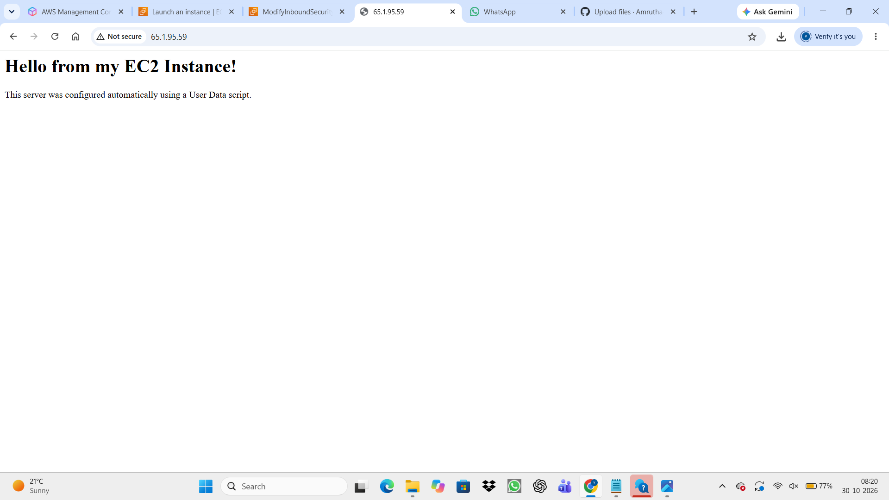
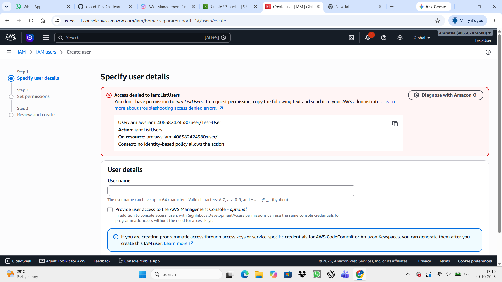
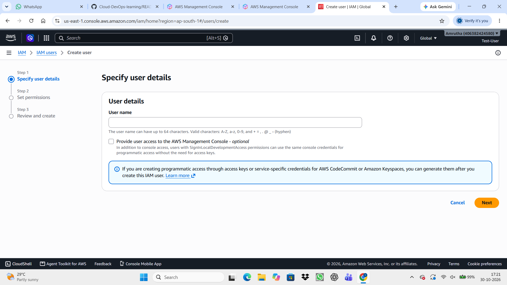

# Cloud-DevOps-learning

Learning Linux, Git, cloud computing and DevOps through hands-on projects.

## Project 1: Static File Hosting on AWS S3
- *Date:* 29/10/2026
- *Goal:* Learn how to host a file in the cloud.
- *What I did:* 
  1. Logged into the AWS Console.
  2. Created a new S3 bucket in the ap-south-1 (Mumbai) region.
  3. Uploaded a test file.
  4. Retrieved the Object URL to verify it was accessible.

## Project 2: Static Website Hosting on AWS S3
- *Date:* 29/10/26
- *Goal:* Host a static HTML website on AWS S3 and make it publicly accessible.
- *What I did:* 
  1. Wrote a basic index.html file.
  2. Created an S3 bucket and uploaded the file.
  3. Enabled Static Website Hosting.
  4. *Troubleshooting:* Overcame "Access Denied" errors by disabling both Bucket-level and Account-level "Block Public Access" settings, then applied a JSON Bucket Policy to allow s3:GetObject for everyone.
  5. Successfully accessed the live website via the S3 endpoint URL.
- *Live URL:* http://cloud-portfolio-amrutha.s3-website.ap-south-1.amazonaws.com

  ## Project 3: Automated EC2 Web Server
- *Date:* 30/10/2026
- *Goal:* Launch an EC2 instance and use a User Data script to automatically install and configure an Apache web server.
- *What I did:* 
  1. Launched an Amazon Linux t3.micro EC2 instance.
  2. Configured the Security Group to allow SSH (port 22) and HTTP (port 80) traffic.
  3. Wrote a bash script in the User Data field to update the OS, install Apache (httpd), start the service, and create a custom index.html page.
  4. Successfully verified the web server was running by accessing the EC2 Public IPv4 address.
- *Key Learning:* Learned how to automate server provisioning and configuration, eliminating the need for manual SSH setup
- 

  ## Project 4: IAM (Identity and Access Management) Security & Access Control
- *Date:* 30/10/2026
- *Goal:* Secure the AWS account by creating a dedicated IAM user, and understand how IAM policies control access to AWS resources using the Principle of Least Privilege.
- *What I did:* 
  1. Created a new IAM user (Amrutha-Admin) with Console access and attached the AdministratorAccess policy.
  2. Logged in via the IAM-specific sign-in URL in an incognito window to verify access, abandoning the Root account for daily tasks.
  3. Created a second user (Test-User) with *no policies attached*.
  4. Logged in as Test-User and attempted to view S3 buckets. Successfully triggered an "Access Denied" error, proving the user had zero permissions.
  5. Attached the AmazonS3FullAccess policy to Test-User, but discovered a new error: the user still couldn't list buckets because they lacked the s3:ListAllMyBuckets account-level permission.
  6. Escalated Test-User to AdministratorAccess to bypass the limitation and successfully created an S3 bucket.
- *Key Learning:* Demonstrated how AWS evaluates IAM policies to allow or deny actions. Learned that service-specific policies (like AmazonS3FullAccess) sometimes aren't enough if the user lacks broader account-level permissions. Also learned the importance of deleting test users to close security holes.

  ### Troubleshooting Evidence
*1. Access Denied (Before Permissions):*

*2. Access Granted (After Admin Permissions):*

