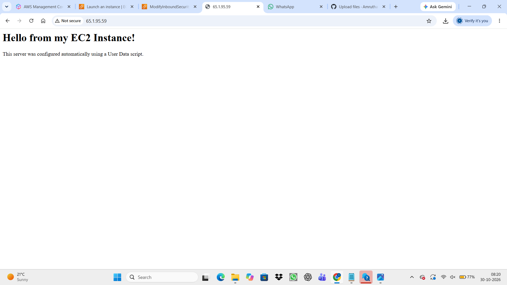
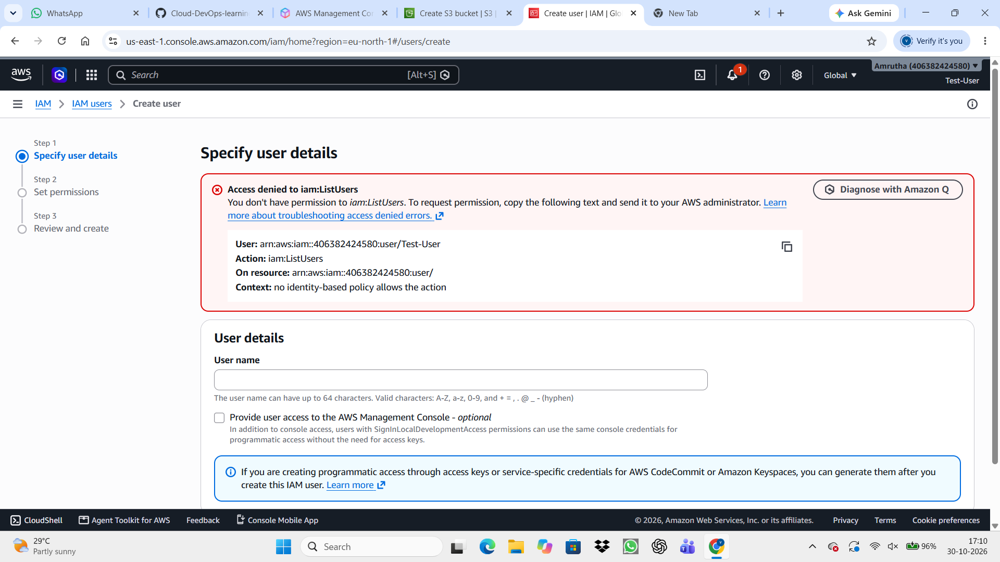
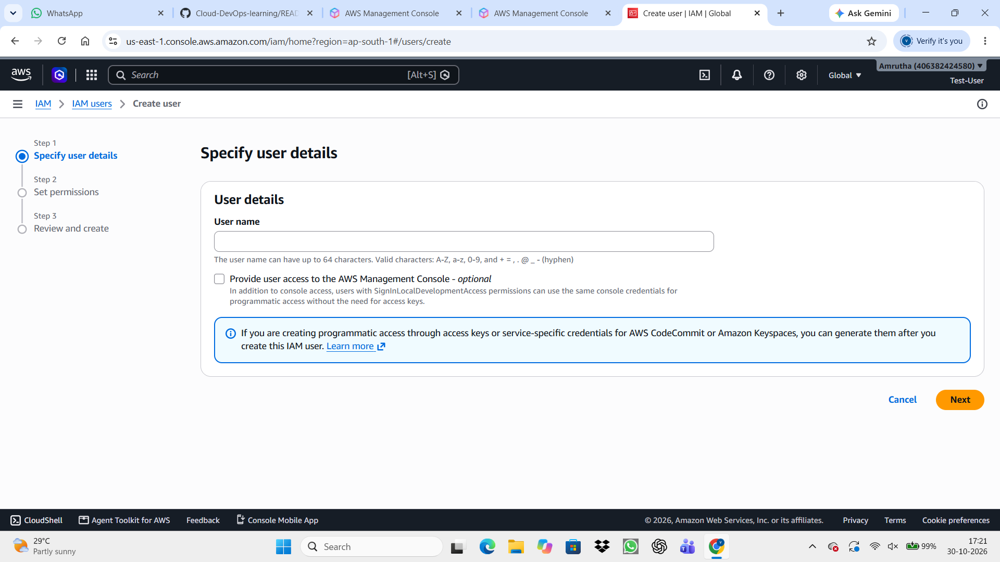
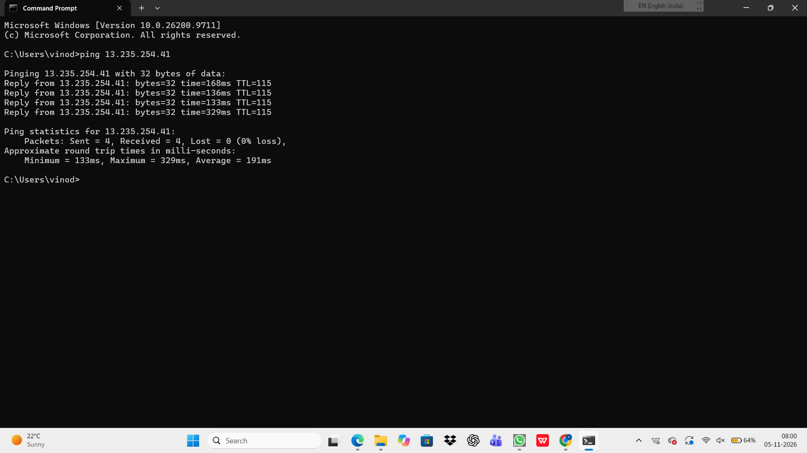
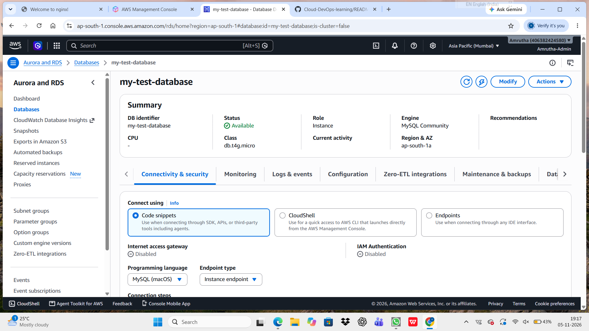
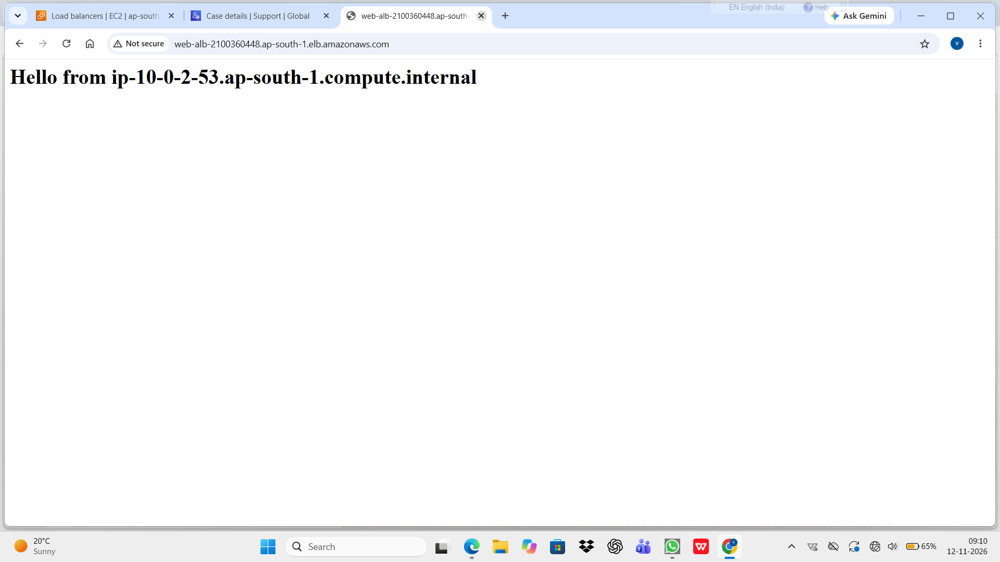

# Cloud-DevOps-learning

Learning Linux, Git, cloud computing and DevOps through hands-on projects.

## Project 1: Static File Hosting on AWS S3

- *Date:* 29/10/2026
- *Goal:* Learn how to host a file in the cloud.
- 
- *What I did:* 
  1. Logged into the AWS Console.
  2. Created a new S3 bucket in the ap-south-1 (Mumbai) region.
  3. Uploaded a test file.
  4. Retrieved the Object URL to verify it was accessible.

## Project 2: Static Website Hosting on AWS S3

- *Date:* 29/10/26
- *Goal:* Host a static HTML website on AWS S3 and make it publicly accessible.
- 
- *What I did:* 
  1. Wrote a basic index.html file.
  2. Created an S3 bucket and uploaded the file.
  3. Enabled Static Website Hosting.
  4. *Troubleshooting:* Overcame "Access Denied" errors by disabling both Bucket-level and Account-level "Block Public Access" settings, then applied a JSON Bucket Policy to allow s3:GetObject for everyone.
  5. Successfully accessed the live website via the S3 endpoint URL.
- *Live URL:* http://cloud-portfolio-amrutha.s3-website.ap-south-1.amazonaws.com

  ## Project 3: Automated EC2 Web Server
  
- *Date:* 30/10/2026
- *Goal:* Launch an EC2 instance and use a User Data script to automatically install and configure an Apache web server.
- 
- *What I did:* 
  1. Launched an Amazon Linux t3.micro EC2 instance.
  2. Configured the Security Group to allow SSH (port 22) and HTTP (port 80) traffic.
  3. Wrote a bash script in the User Data field to update the OS, install Apache (httpd), start the service, and create a custom index.html page.
  4. Successfully verified the web server was running by accessing the EC2 Public IPv4 address.
- *Key Learning:* Learned how to automate server provisioning and configuration, eliminating the need for manual SSH setup
- 

  ## Project 4: IAM (Identity and Access Management) Security & Access Control
  
- *Date:* 30/10/2026
- *Goal:* Secure the AWS account by creating a dedicated IAM user, and understand how IAM policies control access to AWS resources using the Principle of Least Privilege.
- 
- *What I did:* 
  1. Created a new IAM user (Amrutha-Admin) with Console access and attached the AdministratorAccess policy.
  2. Logged in via the IAM-specific sign-in URL in an incognito window to verify access, abandoning the Root account for daily tasks.
  3. Created a second user (Test-User) with *no policies attached*.
  4. Logged in as Test-User and attempted to view S3 buckets. Successfully triggered an "Access Denied" error, proving the user had zero permissions.
  5. Attached the AmazonS3FullAccess policy to Test-User, but discovered a new error: the user still couldn't list buckets because they lacked the s3:ListAllMyBuckets account-level permission.
  6. Escalated Test-User to AdministratorAccess to bypass the limitation and successfully created an S3 bucket.
     
- *Key Learning:* Demonstrated how AWS evaluates IAM policies to allow or deny actions. Learned that service-specific policies (like AmazonS3FullAccess) sometimes aren't enough if the user lacks broader account-level permissions. Also learned the importance of deleting test users to close security holes.

  ### Troubleshooting Evidence
  
*1. Access Denied (Before Permissions):*

*2. Access Granted (After Admin Permissions):*

## Project 6: Verifying Custom VPC Connectivity

*Date:* 5/11/2026
*Goal:* Prove that the custom VPC, Public Subnet, and Route Table routing are configured correctly by launching a server and pinging it from the public internet.

*What I did:*
  1. Launched an EC2 instance (VPC-Test-Server) inside the custom My-Custom-VPC and selected the Public-Subnet.
  2. Ensured a Public IPv4 address was automatically assigned to the instance.
  3. Created a Security Group allowing SSH (port 22) and All ICMP - IPv4 traffic.
  4. Connected to the instance's Public IPv4 address using the ping command from my local Windows Command Prompt.
  5. Verified successful packet transfer (0% loss), proving the Internet Gateway and custom Route Table were functioning perfectly.
  6. Terminated the instance to avoid billing.
     
*Key Learning:* Validated that AWS networking functions exactly like physical networking. Without a Route Table pointing to an Internet Gateway, instances remain isolated. This project proved the end-to-end flow of internet traffic into a custom cloud network.

### Proof of VPC Connectivity

## Project 8: CI/CD with GitHub Actions

- *Date:* 5/11/2026
- *Goal:* Understand the fundamentals of Continuous Integration by automating the testing of a Python script using GitHub Actions.
- 
- *What I did:*
  1. Created a simple Python script (hello.py).
  2. Created a GitHub Actions workflow file (.github/workflows/python-test.yml).
  3. Configured the workflow to trigger on every push to the main branch.
  4. *Troubleshooting:* Encountered an error where the ubuntu-latest runner did not have Python 3.9 cached. Fixed the pipeline by specifying runs-on: ubuntu-24.04 in the YAML file.
  5. The workflow automatically spins up an Ubuntu runner, sets up Python, and executes the script.
  6. Verified the successful run (green checkmark) via the GitHub Actions tab.
     
- *Key Learning:* Learned the basics of YAML syntax, how to read GitHub Actions logs to debug failures, and how CI/CD pipelines automate the testing of code.

  ## Project 9: Secure Database with Amazon RDS
  
- *Date:* 5/11/2026
- *Goal:* Provision a managed MySQL database in a private subnet to understand secure database architecture and network isolation.
- 
- *What I did:*
  1. Created an Amazon RDS MySQL database (db.t3.micro) using the Free Tier template and Single-AZ deployment.
  2. Placed the database inside the custom My-Custom-VPC.
  3. *Troubleshooting:* Initially hit a "No default subnet detected" error. Resolved this by creating a *DB Subnet Group* spanning two Availability Zones (ap-south-1a and ap-south-1b).
  4. Encountered a CIDR overlap error while creating the second subnet; fixed it by assigning a new CIDR block (10.0.3.0/24) to the private subnet.
  5. Set *Public access to "No"* and attached a new security group, ensuring the database cannot be reached from the internet.
  6. Deleted the database immediately after verifying the configuration to avoid charges.
- *Key Learning:* Learned why databases must be isolated in private subnets and how RDS uses DB Subnet Groups to span multiple Availability Zones for high availability.

### RDS Configuration Screenshot

## Project 10: High Availability Architecture (ALB + Auto Scaling)

- *Date:* 12/11/2026
- *Goal:* Build a highly available, fault-tolerant web application that automatically scales based on demand.
- 
- *What I did:*
  1. Created a Launch Template with a User Data script to install Apache and display the server hostname.
  2. Created a Target Group and an Internet-facing Application Load Balancer (ALB) across multiple Availability Zones.
  3. Created an Auto Scaling Group (min 1, max 4) attached to the ALB.
  4. Verified load balancing by refreshing the ALB DNS and observing the hostname change.
  5. *Troubleshooting:* Encountered an "Unhealthy" target because the Auto Scaling Group placed an instance in the Private Subnet, which lacks a NAT Gateway to respond to health checks. Resolved by reconfiguring the Auto Scaling Group to use only the Public Subnet.
- *Key Learning:* Learned how to decouple architecture components. The Load Balancer acts as a single point of contact for users, while the Auto Scaling Group ensures server capacity adapts automatically.

### Proof of High Availability

